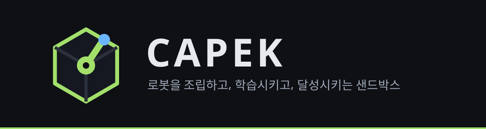
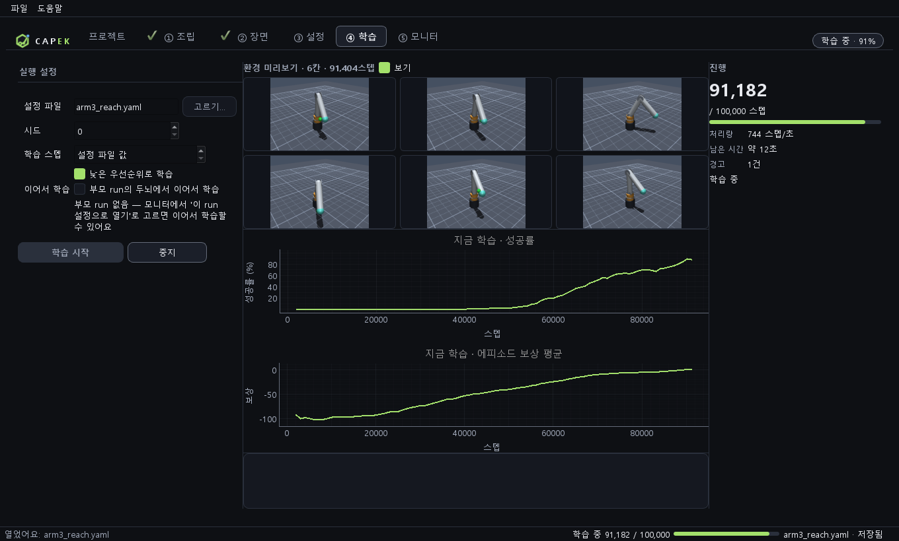
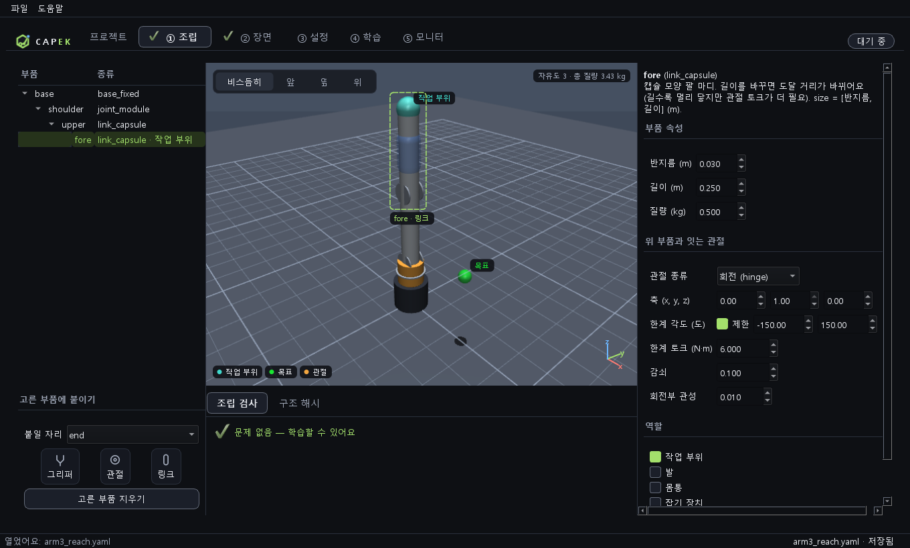
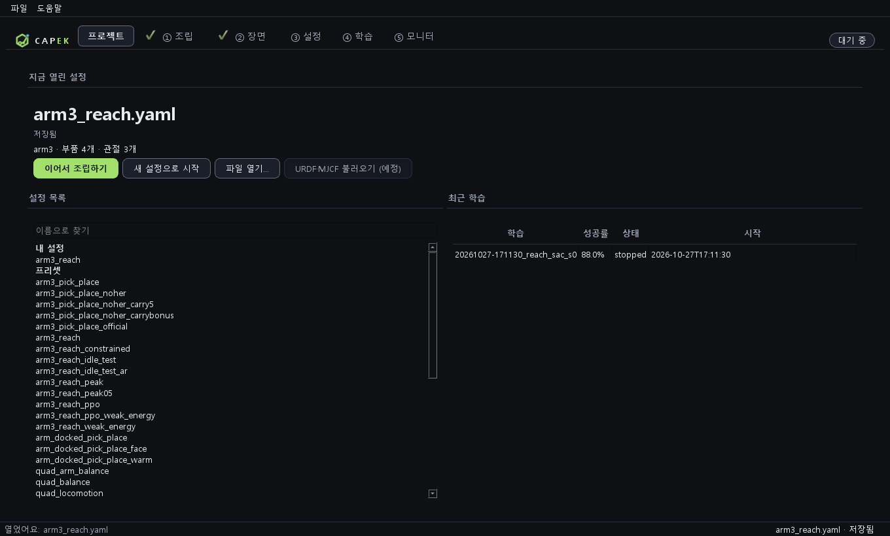
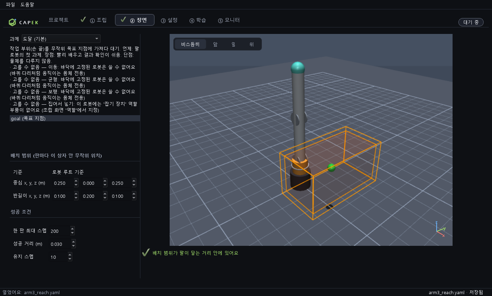

  

<h3 align="center">부품을 이어 붙여 로봇을 만들고, 강화학습으로 과제를 달성시키세요.</h3>

  프로젝트 · 조립 · 장면 · 학습 · 모니터 · 3D 재생 · AI 조언. 
  파이썬도, 개발 도구도, GPU도 필요 없어요. 설치파일 하나로 Windows에서 바로 돌아가요.

  
  
  

  <a href="https://github.com/Dawnilove/CAPEK/releases/latest"><b>⬇ CAPEK-Setup.exe 내려받기</b></a>

> 이 저장소는 **배포용**이에요. 설치파일과 사용 설명만 있고, 소스 코드는 공개하지 않아요.

## ✨ 주요 기능

- 🏠 **프로젝트** — 첫 화면에서 설정과 최근 학습을 고르고, 새 조립을 시작해요.
- 🧩 **조립** — 링크·관절·바퀴·다리·그리퍼를 카드로 이어 붙이고, 3D 화면에서 바로 확인해요. 고른 부품은 점선 상자로, 작업 부위·목표는 이름표로 보여요. 조립이 잘못되면 이유를 알려 줘요.
- 🎯 **과제** — 팔 뻗기 · 이동 · 균형 · 걷기 · 집어서 옮기기. 배치 범위와 성공 조건을 직접 정해요.
- 📈 **학습** — 시작 버튼 하나로 강화학습(SAC·PPO)을 돌려요. 진행 패널·곡선·병렬 환경 미리보기가 실시간으로 움직이고, 창을 닫아도 학습은 계속돼요.
- 🗂 **모니터** — 학습 기록을 모아 비교해요. 설정이 어디가 달라졌는지, 조상 run이 무엇인지까지 보여 줘요.
- 🎬 **3D 재생** — 끝난 학습을 3D로 다시 봐요.
- 🩺 **자동 진단** — 학습이 막히면 원인 후보를 알려 주고, 안전한 것은 스스로 고쳐요.
- 🤖 **AI 조언 (선택)** — 분석가 2명이 따로 기록을 보고, **의견이 같은 것만** 설정 제안으로 보여 줘요. 적용은 새 설정 파일로만 되고, 학습은 자동으로 시작하지 않아요.
- 💾 **내 데이터는 내 PC에** — 모든 기록은 `문서\CAPEK`에 저장돼요.

  

<table>
  <tr>
    <td width="50%"> <b>조립</b> · 부품 카드로 붙이고, 3D에서 작업 부위와 목표를 확인해요</td>
    <td width="50%"> <b>프로젝트</b> · 설정과 최근 학습을 고르는 첫 화면</td>
  </tr>
  <tr>
    <td width="50%"> <b>장면</b> · 과제를 고르고 목표가 나올 범위를 상자로 정해요</td>
    <td width="50%"></td>
  </tr>
</table>

## ⬇ 설치

1. **Releases**에서 `CAPEK-Setup.exe`를 내려받아요.
2. 더블클릭해서 설치해요. 관리자 권한은 필요 없어요.
3. "알 수 없는 게시자" 경고가 뜨면 **추가 정보 → 실행**을 눌러요. (코드 서명이 아직 없어요.)
4. 시작 메뉴에서 **CAPEK**을 열어요.

지우려면 설정 → 앱에서 CAPEK을 제거해요. 학습 기록(`문서\CAPEK`)은 남아요.

## 🖥 필요한 것
- Windows 10 또는 11, 64비트
- 메모리 8 GB 이상 권장, 디스크 약 1 GB
- GPU는 필요 없어요. 3D가 안 되는 PC에서는 소프트웨어 방식으로 자동 전환해요.

## 📁 내 데이터는 어디에 저장되나

`문서\CAPEK` 폴더예요.

| 폴더 | 내용 |
|---|---|
| `runs\` | 학습 기록과 학습된 두뇌 |
| `my_configs\` | 조립 화면에서 저장한 설정 |
| `logs\` | 문제가 생겼을 때 볼 로그 |

다른 폴더를 쓰려면 환경변수 `CAPEK_DATA_DIR`을 설정해요.

## 🤖 AI 조언 (선택)
- 모니터 탭의 **AI 조언 받기** 버튼으로 써요. 본인의 Anthropic API 키가 필요해요.
- 처음 쓸 때 안내를 읽고 동의해야 해요. 학습 설정과 지표 요약이 Anthropic으로 전송돼요. **파일 경로와 API 키는 보내지 않아요.**
- 비용은 본인의 Anthropic 계정에 청구돼요. 호출 전에 예상 비용을 보여 주고 확인을 받아요. 한 번에 약 $0.1~0.3이에요.
- API 키는 Windows 자격 증명 관리자에 저장해요. 파일에는 저장하지 않아요.
- 조언은 참고용이에요. 자동으로 적용하거나 학습을 시작하지 않아요.

## 🛟 문제가 생기면
1. `문서\CAPEK\logs\gui.log`를 열어요.
2. 로그와 화면 문구를 [이슈](https://github.com/Dawnilove/CAPEK/issues)에 적어 주세요.
3. 보안 문제는 [SECURITY.md](SECURITY.md)를 봐 주세요.

## 알려진 한계
- Windows만 지원해요. 다른 운영체제는 나중에 넓혀요.
- 코드 서명이 없어 첫 실행에 경고가 떠요. 일부 백신이 새 프로그램을 의심할 수 있어요.
- 학습은 CPU로 해요. 큰 과제는 오래 걸려요.

## 📄 라이선스
개인 학습·교육·연구 목적은 무료예요. 재배포, 수정, 역공학, 상업적 사용은 허용하지 않아요. 보증은 없어요. 전문은 [LICENSE.txt](LICENSE.txt)를 봐 주세요.
